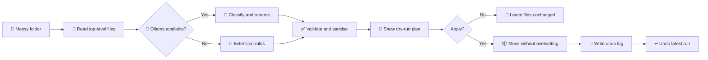

# sloth-tidy


A lazy, local, undoable file tidier. A small open-weight model running in
[Ollama](https://ollama.com) reads each file's name and a short snippet,
picks a category and a clean file name, and moves it. Nothing leaves your
machine.

Built for the DEV Hacktoberfest Open-Source AI Challenge, Week 3: *Slow and Steady*.
Started and finished inside the challenge window (Oct 19 to Oct 25, 2026).



## Quick start

```bash
ollama pull llama3.2:3b          # or any model you like
python3 make_mess.py ./messy     # optional: a demo folder full of clutter
python3 sloth_tidy.py tidy ./messy            # dry run: shows the plan only
python3 sloth_tidy.py tidy ./messy --apply    # do it
python3 sloth_tidy.py undo ./messy            # changed your mind? put it all back
python3 sloth_tidy.py watch ~/Downloads --every 600   # tidy forever, slowly
python3 sloth_tidy.py gui                     # prefer clicking? opens a local web UI
```

No dependencies beyond Python 3.9+ and a running Ollama.

## Graphical interface

`python3 sloth_tidy.py gui` starts a small web UI on `http://127.0.0.1:8765` and opens it in your browser. Pick a folder (paste a path or browse), pick any model you have pulled in Ollama, press **Take a look** to see the plan grouped by category, untick anything you disagree with, then **Move the selected files**. **Undo last tidy** reverses it.

It is still 100% local and still standard library only. The server listens on loopback only, rejects requests for other host names, and the API needs a per-session token, so a random web page in your browser cannot drive it. The server re-validates every move it is asked to make (file must exist directly in the folder, category must be on the list, names are re-slugified).

## Options

| Flag | Meaning |
|---|---|
| `--model NAME` | Any Ollama model you have pulled (default `llama3.2:3b`) |
| `--host URL` | Ollama address (default `http://localhost:11434`) |
| `--no-ai` | Skip the model, use extension rules only |
| `--port N` | `gui` only: port for the web UI (default 8765) |
| `--no-browser` | `gui` only: don't open a browser tab automatically |
| `--apply` | Actually move files (default is a dry run) |
| `--every N` / `--settle N` | `watch` only: nap length, and ignore files newer than N seconds |

## Safety, because a lazy tool must not be a reckless one

- **Dry run by default.** You see the plan before anything moves.
- **Undo.** Every real run is logged to `.sloth-tidy-log.json` inside the folder; `undo` reverses the latest run.
- **No overwrites.** Name collisions get `-1`, `-2` suffixes.
- **The model cannot choose paths.** It returns JSON constrained to a fixed list of categories plus a name; the name is slugified, so `../../evil` becomes `evil`. Unknown categories are discarded.
- **Graceful degradation.** If Ollama is down, or the model returns junk for a file, that file falls back to simple extension rules.
- Only top-level files are touched; sub-folders and dotfiles are left alone.

## Tests

```bash
python3 -m unittest -v
```

The tests run against a fake Ollama HTTP server, so they need no GPU and no model.

## How it works

1. For each file: name, size, and the first 600 characters (text-like files only) go to `POST /api/chat`.
2. Ollama's structured output (`format` = JSON schema) forces `{category, new_name}`.
3. The result is validated and sanitised, then planned, shown, and optionally applied.

Swap the model, edit the category list or the prompt at the top of `sloth_tidy.py`, and the behaviour changes. That is the point of using open weights.

## CI/CD

- `.github/workflows/ci.yml` runs on every push and PR: syntax check, the unit tests on Python 3.9, 3.11 and 3.13, and a dry-run/apply/undo smoke test of the CLI. No model or GPU is needed in CI.
- `.github/workflows/release.yml` runs when you push a tag like `v1.0.0`: it re-runs the tests, builds a zip and publishes a GitHub release.

```bash
git tag v1.0.0 && git push origin v1.0.0
```

## License

MIT
