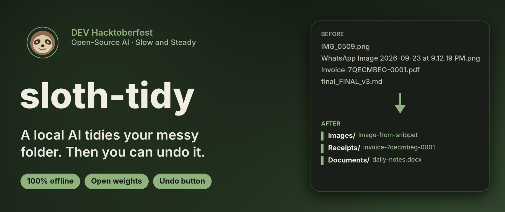
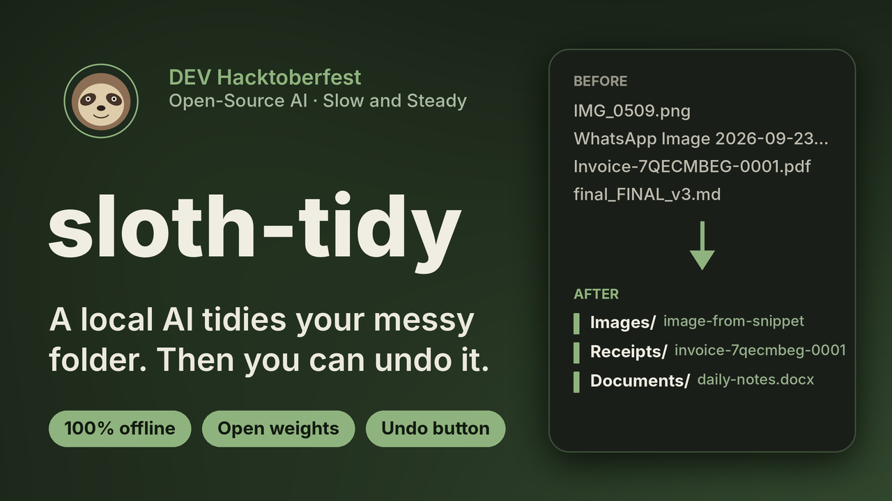
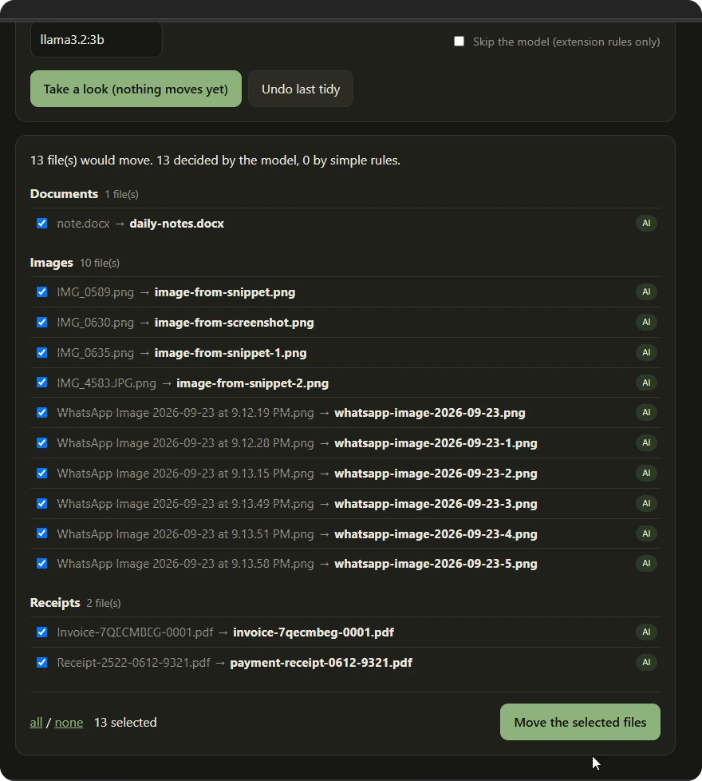
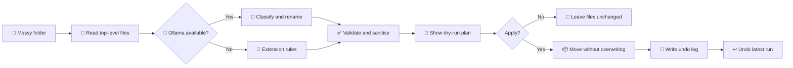

<p align="center">
  
</p>

<p align="center">
  <a href="https://github.com/Hasalawa/sloth-tidy/actions/workflows/ci.yml"></a>
  
  
  
  
  <a href="LICENSE"></a>
</p>

<h3 align="center">A lazy, local, undoable file tidier.</h3>

<p align="center">
  A small open-weight model running in <a href="https://ollama.com">Ollama</a> reads each file's name and a short snippet,<br>
  picks a category and a clean file name, and moves it. <b>Nothing leaves your machine.</b>
</p>

<p align="center">
  <a href="https://youtu.be/_PKF_330Mns">
    
  </a><br>
  <sub>▶ Watch the 2-minute demo</sub>
</p>

> Built for the **DEV Hacktoberfest Open-Source AI Challenge, Week 3: *Slow and Steady***.
> Started and finished inside the challenge window (Oct 19 to Oct 25, 2026).

---

## ✨ Why you might like it

| | |
|---|---|
| 🧠 **Reads, not just sorts** | A rule engine only sees the extension. The model also sees the file's name and, for text files, its first lines, so an invoice can land in `Receipts/` with a readable name. |
| 🔒 **Private by construction** | Files are read by a model on your own machine. No API key, no upload, works offline. |
| 👀 **Look before it moves** | Dry run by default. You get a plan grouped by category and can untick anything. |
| ↩️ **Undo button** | Every run is logged. One click puts every file back where it was. |
| 🖱️ **Click or type** | A small browser UI (`gui`), a CLI, and a `watch` mode that tidies a folder in the background. |
| 🪶 **Zero dependencies** | One Python file, standard library only. Swap the model or the prompt in seconds. |

<p align="center">
  <br>
  <sub>The review screen, from a real run: 13 files, decided by <code>llama3.2:3b</code>. Untick anything you disagree with, then move.</sub>
</p>

## 🚀 Quick start

You need [Python 3.9+](https://www.python.org/downloads/) and [Ollama](https://ollama.com/download).

```bash
# 1. get a small model (about 2 GB, once)
ollama pull llama3.2:3b

# 2. get the code
git clone https://github.com/Hasalawa/sloth-tidy.git
cd sloth-tidy

# 3. open the app
python3 sloth_tidy.py gui        # on Windows: python sloth_tidy.py gui
```

Your browser opens on `http://127.0.0.1:8765`. Pick a folder, press **Take a look**, review the plan, press **Move the selected files**. Changed your mind? **Undo last tidy**.

Want a folder to practise on? `python3 make_mess.py ./messy` creates one full of clutter.

## 🧭 How it works



1. For each file, the name, size and the first 600 characters (text-like files only) go to Ollama's `POST /api/chat`.
2. Ollama's **structured output** (`format` = a JSON schema, with `category` as an enum) forces the reply to be `{category, new_name}`. That is what makes a 3B model dependable enough for this job.
3. The reply is treated as **untrusted advice**: it is validated and sanitised, then planned, shown, and optionally applied.

Swap the model, edit the category list or the prompt at the top of `sloth_tidy.py`, and the behaviour changes. That is the point of using open weights.

## 💻 Command line

```bash
python3 sloth_tidy.py tidy  ./messy             # dry run: shows the plan only
python3 sloth_tidy.py tidy  ./messy --apply     # do it
python3 sloth_tidy.py undo  ./messy             # put the last run back
python3 sloth_tidy.py watch ~/Downloads --every 600   # tidy forever, slowly
python3 sloth_tidy.py --no-ai tidy ./messy      # skip the model, extension rules only
python3 sloth_tidy.py --model qwen2.5:3b gui    # use any model you have pulled
```

<details>
<summary><b>All options</b></summary>

| Flag | Meaning |
|---|---|
| `--model NAME` | Any Ollama model you have pulled (default `llama3.2:3b`) |
| `--host URL` | Ollama address (default `http://localhost:11434`) |
| `--no-ai` | Skip the model, use extension rules only |
| `--apply` | `tidy` only: actually move files (default is a dry run) |
| `--port N` | `gui` only: port for the web UI (default 8765) |
| `--no-browser` | `gui` only: don't open a browser tab automatically |
| `--every N` / `--settle N` | `watch` only: nap length in seconds, and ignore files newer than N seconds |

Global flags (`--model`, `--host`, `--no-ai`) go **before** the command, e.g. `python3 sloth_tidy.py --model qwen2.5:3b gui`.

</details>

## 🛡️ Safety, because a lazy tool must not be a reckless one

- **Dry run by default.** You see the plan before anything moves.
- **Undo.** Every real run is logged to `.sloth-tidy-log.json` inside the folder; `undo` reverses the latest run, even if some files were skipped.
- **No overwrites.** Name collisions get `-1`, `-2` suffixes.
- **The model cannot choose paths.** It returns JSON constrained to a fixed list of categories plus a name; the name is slugified, so `../../evil` becomes `evil`. Unknown categories are discarded.
- **Locked files are skipped, not fatal.** A file open in another program is left where it is, reported, and everything else still moves and stays undoable.
- **Leaves alone:** sub-folders, dotfiles, unfinished downloads (`.crdownload`, `.part`, `.tmp`), Office lock files (`~$...`), `desktop.ini`, `Thumbs.db`, and Windows hidden or system files.
- **Graceful degradation.** If Ollama is down, or the model returns junk for a file, that file falls back to simple extension rules.
- **Local UI, locked down.** The web UI listens on loopback only, rejects requests for other host names, needs a per-session token, and re-validates every move it is asked to make.

## 🧰 Troubleshooting

<details>
<summary><b>The dropdown says "Ollama not detected" / everything is tagged <code>rule</code></b></summary>

Ollama isn't running or isn't on the default address. Start the Ollama app (or `ollama serve`), check `ollama list` shows your model, and if it listens elsewhere pass `--host http://your-address:11434`.
</details>

<details>
<summary><b>It's slow</b></summary>

On a laptop CPU, `llama3.2:3b` took about a minute for 13 files in the demo. Each file is one model call. Options: use a smaller model, run `watch` in the background instead of waiting, or use `--no-ai` for instant extension-rule sorting.
</details>

<details>
<summary><b>"Skipped … (is it open in another program?)"</b></summary>

Windows won't move a file that another program has open. Close it and run again; everything else was already moved and can still be undone.
</details>

<details>
<summary><b>The AI gave my photos generic names</b></summary>

The model only sees a file's name and (for text files) its first 600 characters, never the pixels, so `IMG_0509.png` becomes something like `image-from-snippet.png`. That is why there is a review step. A bigger model, or a vision model with a tweaked prompt, would do better.
</details>

## 🧪 Tests and CI

```bash
python3 -m unittest -v
```

The 20 tests run against a **fake Ollama server**, so they need no GPU and no model. They cover apply/undo, path traversal, name collisions, garbage model output, Ollama being offline, one slow file, locked files, unfinished downloads, Windows reserved names, and tampered requests to the web UI.

- `.github/workflows/ci.yml` runs on every push and PR: syntax check, the tests on Python 3.9, 3.11 and 3.13, and a dry-run/apply/undo smoke test of the CLI.
- `.github/workflows/release.yml` runs when you push a tag like `v1.0.0`: it re-runs the tests, builds a zip and publishes a GitHub release.

```bash
git tag v1.0.0 && git push origin v1.0.0
```

## 📁 What's in the repo

| Path | What |
|---|---|
| `sloth_tidy.py` | The whole tool: CLI, planner, undo log, and the local web UI |
| `test_sloth_tidy.py` | Tests, using a fake Ollama server |
| `make_mess.py` | Makes a messy practice folder |
| `assets/` | README images |
| `.github/workflows/` | CI and release automation |

## 📜 License

[MIT](LICENSE) © H.T.Kehan Hasalawa
